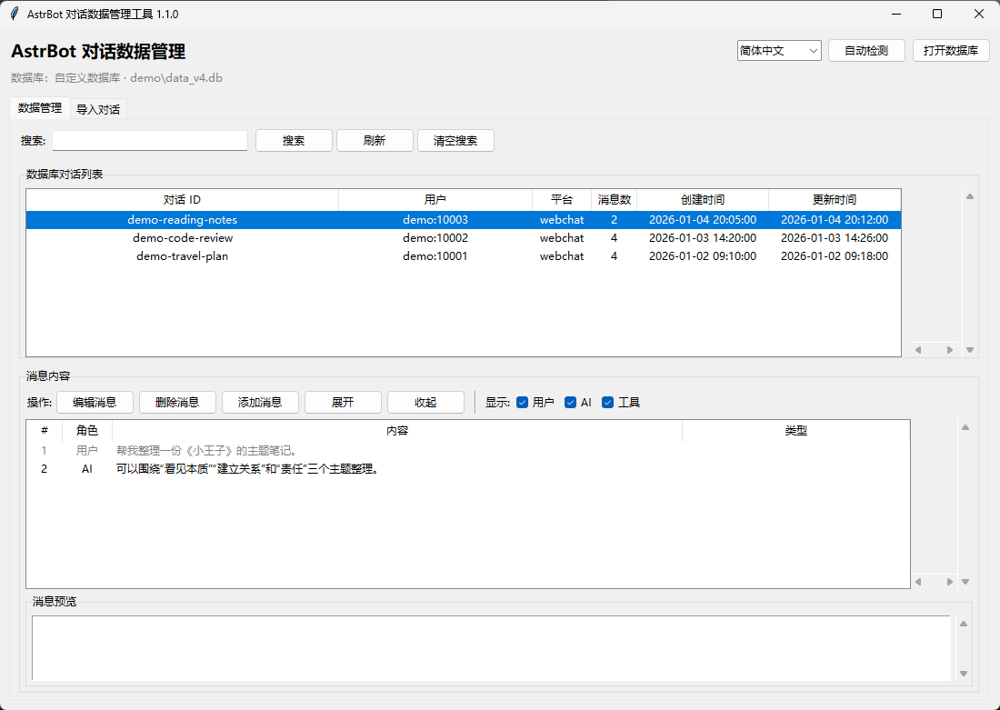
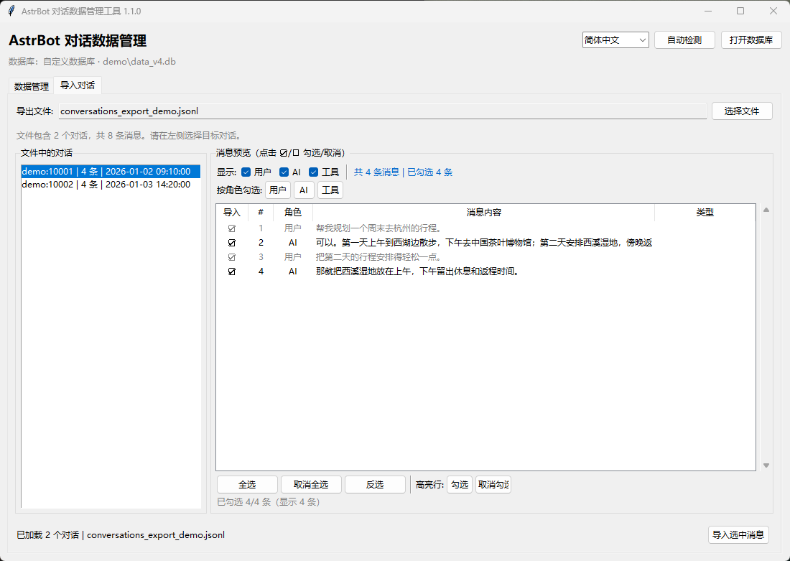

# AstrBot Conversation Manager

[简体中文](README.md) | [English](README.en.md)

[](https://github.com/Fin1995/astrbot-conversation-manager/actions/workflows/test.yml)

A small, dependency-free Windows desktop tool for browsing, editing, and importing AstrBot conversation data stored in `data_v4.db`. Legacy `data_v3.db` databases are accepted when they contain the same `conversations` schema. The interface supports Simplified Chinese (default) and English; use the language selector in the header or `--lang en`.

> Unofficial community tool. Not affiliated with AstrBot. Back up your database and close AstrBot/Launcher before editing.



## Features

| Feature | Description |
|---|---|
| Automatic detection | Finds AstrBot Desktop, Launcher, CLI, and source-checkout databases without a hardcoded username or instance UUID |
| Conversation management | Search, inspect, rename, and delete conversations |
| Message editing | Edit, delete, insert, and merge messages with role filtering |
| Import | Load AstrBot JSONL/JSON exports, select messages, and insert or merge them |
| Safe writes | Schema validation, SQLite transactions, and a timestamped backup before the first write |
| Multiple installs | Shows a picker when more than one valid database is found |
| No runtime dependencies | Python standard library and Tkinter only |
| Automated tests | Cover path detection, database access, import parsing, and UI translation |

### Importing AstrBot exports

AstrBot's JSONL export contains one conversation per line and may contain more than one conversation even when only one row is checked in the WebUI. The import tab lists every conversation in the file and shows the total count; select the conversation on the left before importing. The tool imports only the selected conversation and messages.

## Supported AstrBot data locations

AstrBot does not use one universal database path. The tool checks the official layouts and validates every candidate before using it:

| Install type | Default database path |
|---|---|
| AstrBot Desktop | `%USERPROFILE%\.astrbot\data\data_v4.db` |
| AstrBot Launcher (default) | `%USERPROFILE%\.astrbot_launcher\instances\<instance-id>\core\data\data_v4.db` |
| AstrBot Launcher (custom data dir) | `<data-dir>\instances\<instance-id>\core\data\data_v4.db`; the data dir is read from `%APPDATA%\com.github.raven95676.astrbot-launcher\.data-dir.json` |
| AstrBot source / current directory | `<AstrBot-root>\data\data_v4.db`; `ASTRBOT_ROOT` overrides the root |
| AstrBot CLI / uv install | `~/.local/share/astrbot/data/data_v4.db` |
| Manual selection | File picker, `--db`, or `ASTRBOT_CONVERSATION_DB` |

Detection order:

1. `ASTRBOT_CONVERSATION_DB` or `--db`
2. The last database selected in the UI
3. `ASTRBOT_ROOT`
4. AstrBot Desktop
5. AstrBot Launcher (default and custom data directory)
6. AstrBot CLI
7. Current directory and up to three parent directories
8. Manual selection

`data_v3.db` is checked after `data_v4.db` in each data directory. Every candidate is opened read-only and must contain the `conversations` table with the columns used by the editor. Invalid files are skipped. If several valid databases are found, a picker is shown. There is no hardcoded `C:\Users\...` path or Launcher instance UUID.

## Screenshots

| Data management | Import preview |
|---|---|
|  |  |

The screenshots show the default Chinese UI, use synthetic demo data generated by `python tools/make_demo_data.py`, the default Tk theme, and a window centered on the screen. No personal conversation data is included; use the language selector to switch the UI to English.

## Requirements

- Windows 10 or Windows 11
- Python 3.10 or later, with Tkinter (included in the python.org Windows installer)
- No runtime pip packages

## Run

```powershell
python run.pyw
```

Or from an installed package:

```powershell
python -m pip install .
astrbot-conversation-manager
```

Useful options:

```powershell
python run.pyw --db "C:\path\to\data_v4.db"
python run.pyw --tab import --import-file "conversations_export.jsonl"
python run.pyw --lang en
```

If no database is detected, click **Open database** and select `data_v4.db` or `data_v3.db`.

## Safety and backups

- **Close AstrBot and the Launcher before editing.** If a `-wal` file is present, the tool warns that the database may be in use.
- The first write in a session creates a consistent backup at `conversation-manager-backups/<database>-<timestamp>.db` next to the database.
- The schema is validated before any write; writes use SQLite transactions.
- Renaming a conversation updates `provider_stats.conversation_id` when that table exists.
- `token_usage` is recalculated with the same rough character-based estimate as the original tool. AstrBot may use this value for statistics; it is not a tokenizer.
- Test edits on a copy of the database first.

## Development

```powershell
python -m pip install pytest
python -m pytest -q
python tools/make_demo_data.py
```

The demo database and export are written to `demo/` and are ignored by git. The test workflow runs on Windows with Python 3.10 and 3.12.

## Project structure

```text
README.md                       Chinese documentation (default)
README.en.md                    English documentation
run.pyw                         source-checkout launcher
src/astrbot_conversation_manager/
  app.py                        Tkinter UI and entry point
  db.py                         SQLite access, validation, backups
  importer.py                   JSON/JSONL export parsing
  paths.py                      AstrBot path detection
  i18n.py                       runtime Chinese/English UI translation
tests/                          path, database, import, and i18n tests
tools/make_demo_data.py         synthetic demo data generator
docs/images/                    README screenshots
```

## License

MIT. See [LICENSE](LICENSE).
